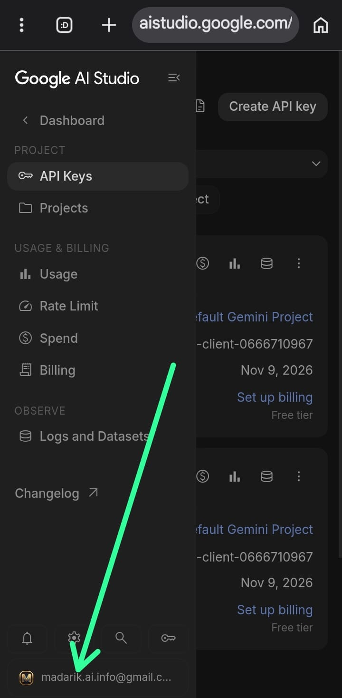

# شرح إستخراج مفاتيح واجهة برمجة التطبيقات API

---

**الخطوة الأولى**

**الدخول إلى "Google AI Studio"**

الخطوة الأولى هي التوجه إلى منصة "Google AI Studio" حيث يمكنك إدارة واستخراج مفاتيح "API" الخاصة بـ "Gemini". اضغط على الرابط التالي:

**الدخول من هنا 👇** 
<a href="https://aistudio.google.com/api-keys">الدخول إلىGoogle AI Studio</a>

---

**الخطوة الثانية**
بعد ما تسجل دخولك تضغط هنا

<i style="color: var(--color-fg-default);">الشكل 1: الضغط على زر إنشاء مفتاح API</i>

[٩‏/١١، ١:١٩ ص] Muhannad Daher: ٣. أ. تكتب هنا اسم للمفتاح 
بـ. إذا عندك مشروع تحب تضيف المفتاح فيه أنا تركته مثل ما هو 
جـ. تضغط هنا
[٩‏/١١، ١:٢٢ ص] Muhannad Daher: ٤. تضغط هنا تنسخ الـ API وبعدها تقفل من الـ ×
[٩‏/١١، ١:٢٤ ص] Muhannad Daher: ٦. طبعاً يكون المفتاح موجود في نفس الصفحة مثل كذا وإذا ما نسخت المفتاح تقدر تنسخه مرة ثانية من هنا
[٩‏/١١، ١:٢٤ ص] Muhannad Daher: ⚠️ أهم شيء هذا المفتاح خاص بك ولا تعطيه لأي شخص
[٩‏/١١، ١:٢٧ ص] Muhannad Daher: وتقدر تستخرج مفتاح ثاني من نفس الحساب أنا استخرجت مفتاهين من هذا الحساب
[٩‏/١١، ١:٣٦ ص] Muhannad Daher: وإذا عندك اكثر من حساب في Gmail وما تعرف انت في أي حساب موجود الآن افتح القائمة من فوق وتقدر تغيره تضغط عليه وتظهر لك قائمة تختار الإختيارات 👇
[٩‏/١١، ١:٣٩ ص] Muhannad Daher: ١. تغيير الحساب
٢. تسجيل الخروج
