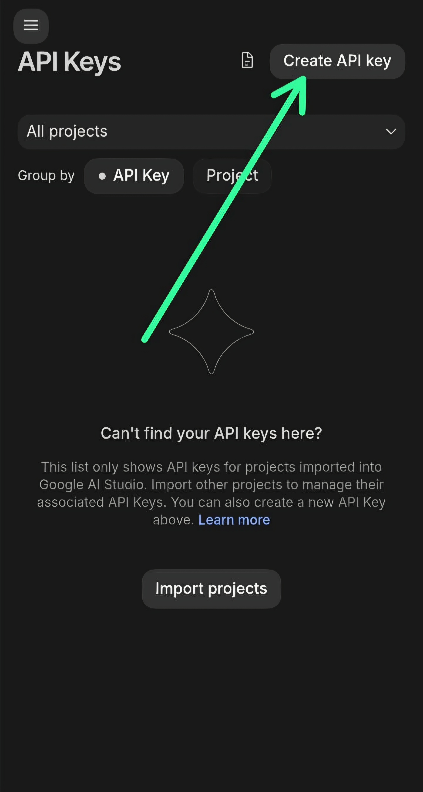
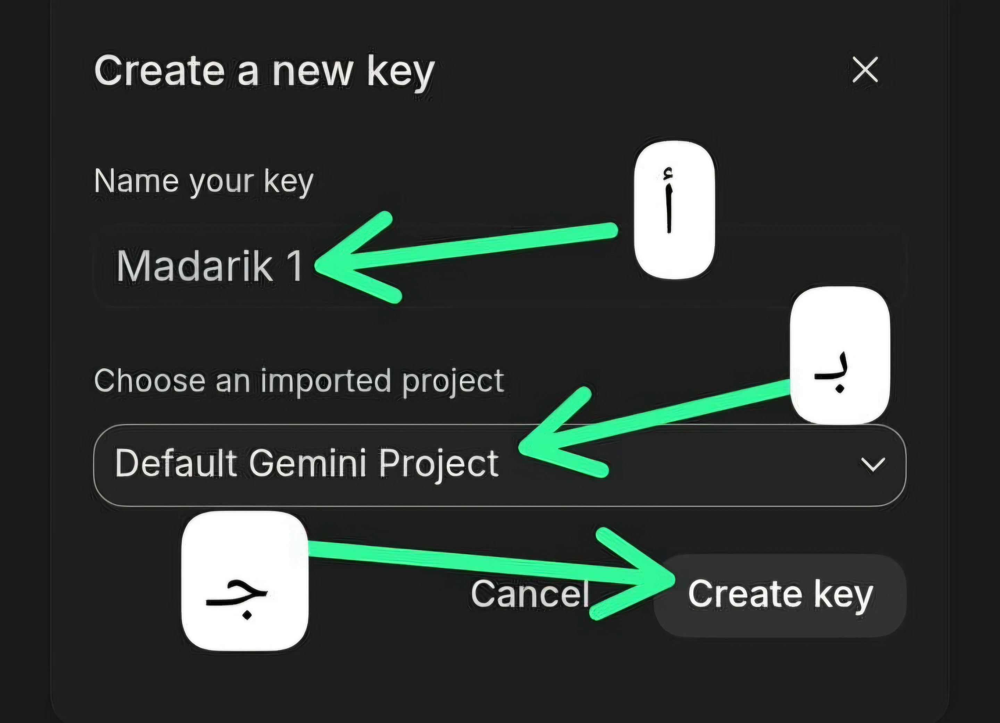
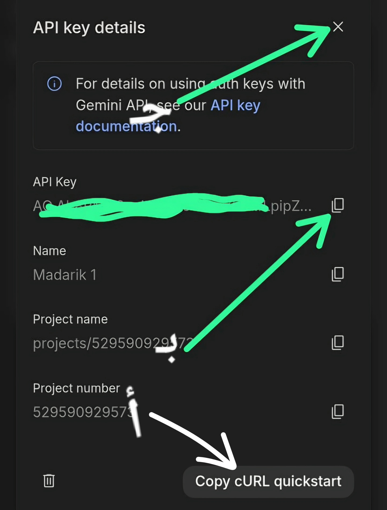
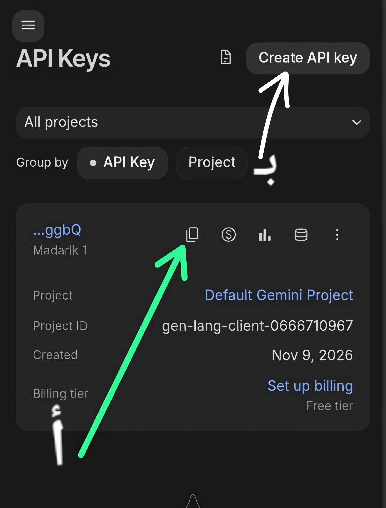

# شرح إستخراج مفاتيح واجهة برمجة التطبيقات API

---

**الخطوة الأولى**

**الدخول إلى "Google AI Studio"**

الخطوة الأولى هي التوجه إلى منصة "Google AI Studio" حيث يمكنك إدارة واستخراج مفاتيح "API" الخاصة بـ "Gemini". اضغط على الرابط التالي:

**الدخول من هنا 👇** 
<a href="https://aistudio.google.com/api-keys">الدخول إلى Google AI Studio</a>

---

**الخطوة الثانية**

بعد أن تسجل دخولك تضغط هنا

<i style="color: var(--color-fg-default);">الشكل 1: الضغط على زر إنشاء مفتاح API</i>

---

**الخطوة الثالثة**

تسمية المفتاح وإنشاؤه

- أ. تكتب هنا اسم للمفتاح

- بـ. إذا عندك مشروع تحب تضيف المفتاح فيه أنا تركته مثل ما هو

- جـ. تضغط هنا

<i style="color: var(--color-fg-default);">الشكل 2: تسمية المفتاح وإنشاؤه</i>

---

**الخطوة الرابعة**

نسخ المفتاح

- أ. تضغط هنا لنسخ المفتاح والإغلاق

- بـ. أو قم بنسخه من هنا

- جـ. ثم أغلق الإطار المنبثق من هنا

<i style="color: var(--color-fg-default);">الشكل 3: النسخ والإغلاق API</i>

---

## ملاحظة مهمة

**⚠️ هذا المفتاح سري للغاية لا تقم بمشاركته مع أي شخص**

---

**أين تجد المفتاح**

- أ. أين تجد المفتاح إذا فقدته أو لم تقم بنسخه سيكون في نفس الصفحة التي دخلت لها في البداية ويمكنك إدارة المفاتيح من نفس الصفحة

- بـ. يمكنك إستخراج أكثر من مفتاح بنفس الطريقة وهي مجانية

<i style="color: var(--color-fg-default);">الشكل 4: لوحة التحكم بالمفاتيح API</i>

---
---

